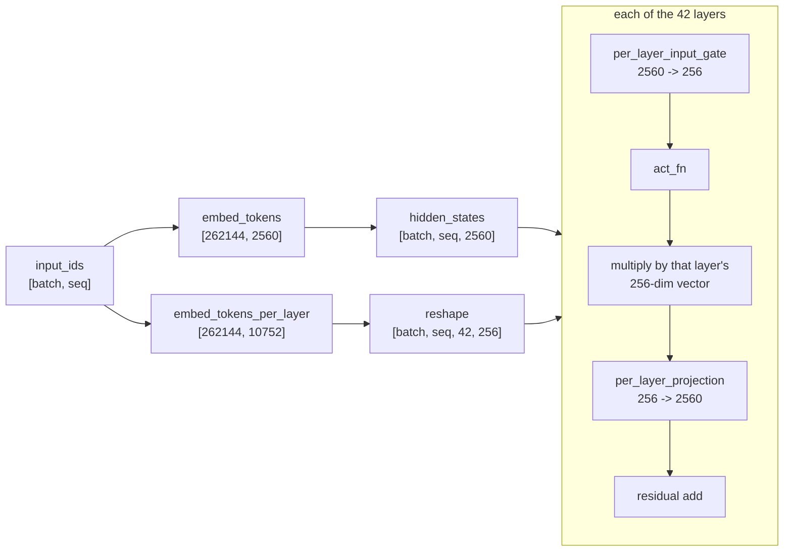
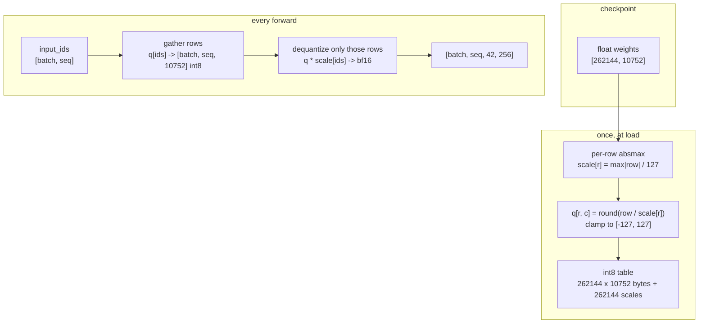
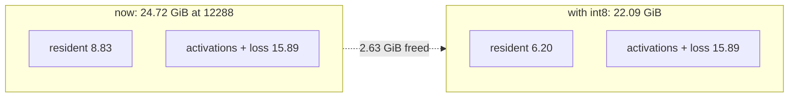

# int8 `embed_tokens_per_layer`: the design

## 1. What the tensor is

The E4B is a MatFormer model: besides the usual token embedding, it carries a
second table that gives **every layer its own 256-dimension vector for the same
token**.

```
model.language_model.embed_tokens.weight            [262144, 2560]     bf16
model.language_model.embed_tokens_per_layer.weight  [262144, 10752]    bf16
                                                      262144 x (42 layers x 256)
```

The forward path, as transformers 5.22.1 implements it:



So the huge table is used as a **lookup**, not as a matrix multiply: for every
token and every layer, one row of 256 values is fetched and multiplied into the
residual stream. `modeling_gemma4.py:1740` is the only read site:

```python
return self.embed_tokens_per_layer(input_ids).reshape(
    *input_ids.shape, self.config.num_hidden_layers, self.hidden_size_per_layer_input
)
```

## 2. Why it costs 5.25 GiB

| State | dtype | Size |
|-------|-------|-----:|
| On disk | bf16 | 5.25 GiB |
| After `prepare_model_for_kbit_training` | fp32 | **10.50 GiB** |
| After our downcast | bf16 | 5.25 GiB |
| **Proposed** | **int8** | **2.63 GiB** |

BitsAndBytes quantizes `Linear` layers, not embedding tables, so this tensor
never enters the 4-bit path. `prepare_model_for_kbit_training` then upcasts every
non-quantized parameter to fp32 for stability, which is where the 10.5 GiB came
from in the first measurement.

Measured resident after the downcast: **8.83 GiB**, of which this table is
**5.25 GiB** — 59% of everything that sits on the card before a single token is
processed.

## 3. The quantization

Symmetric int8, one scale per row, applied at the *gather* rather than to the
whole table:



The critical property: **only the rows that the batch touches are dequantized**.
A 12288-token sequence touches 12288 rows out of 262144, so the dequantization
work is 12288 × 10752 multiply-adds per step — nothing next to the 42 transformer
layers.

Memory cost of the scales: 262144 × 4 bytes = **1 MiB**. Rounding error per value
is at most `scale/2`, i.e. half a step of the row's dynamic range.

A refinement, if per-row proves too coarse: one scale per (row, layer) is
262144 × 42 × 4 bytes = 44 MiB of scales, still negligible against 2.6 GiB, and it
scopes the error to each 256-dim vector instead of the whole 10752-dim row.

## 4. What it buys

| Window | Now (bf16 table) | With int8 table |
|-------:|-----------------:|----------------:|
| resident | 8.83 GiB | **6.20 GiB** |
| 8192 | 19.69 GiB | ~17.06 GiB |
| 12288 | **24.72 GiB** (over the card) | **~22.09 GiB** |
| 16384 | 30.24 GiB | ~27.61 GiB |

The 8192 and 16384 rows are arithmetic on the measured resident delta; the 12288
figure is the one that matters, because it moves the window from *over the card*
to *inside it* with ~2 GiB of margin.



## 5. Where it plugs in

The model exposes a getter and a setter for exactly this module
(`modeling_gemma4.py:1509-1513`), so the swap does not need to patch the forward
pass:

```python
class Int8RowEmbedding(torch.nn.Module):
    """Drop-in for a frozen embedding table stored as int8 + per-row scales."""

    def __init__(self, weight_q: torch.Tensor, scale: torch.Tensor, dtype: torch.dtype):
        super().__init__()
        self.register_buffer("weight_q", weight_q)   # int8, [rows, dims]
        self.register_buffer("scale", scale)         # fp32, [rows]
        self.out_dtype = dtype

    def forward(self, input_ids: torch.Tensor) -> torch.Tensor:
        flat = input_ids.reshape(-1)
        rows = self.weight_q[flat].to(self.out_dtype)
        rows = rows * self.scale[flat].unsqueeze(-1).to(self.out_dtype)
        return rows.view(*input_ids.shape, self.weight_q.shape[1])
```

```python
model.set_per_layer_input_embeddings(
    Int8RowEmbedding(q, scale, torch.bfloat16)
)
```

One detail the design has to preserve: the original module is
`Gemma4TextScaledWordEmbedding`, an `nn.Embedding` subclass that multiplies its
output by `sqrt(hidden_size)`. The replacement must apply the same factor, or the
per-layer gate receives inputs scaled wrong.

## 6. Risks

| Risk | Why it matters | Mitigation |
|------|----------------|------------|
| Quantization degrades the gate | the table multiplies into every residual stream; a bad scaling hurts all 42 layers at once | compare the loss on a fixed batch before and after the swap; the delta must stay under a few percent |
| A second read site exists | the getter is used by `resize_token_embeddings`; a different caller would bypass the wrapper | `modeling_gemma4.py:1740` is the only forward read; the resize path is never called in training |
| The scale should be per (row, layer) | one scale for a 10752-dim row may be too coarse | switch to 42 scales per row for 44 MiB if the loss delta is too large |
| Dequantization cost per step | 12288 gathers of 10752 bytes | measure; the arithmetic says it is small next to the transformer |
| Adapter must still load on the quantized checkpoint | training uses the unquantized weights | unchanged by this work: S5 already validates the adapter against `qat-w4a16-ct` |

## 7. Go / no-go

Build it if the validation is cheap and the delta is honest:

1. Load in 4-bit, downcast, then swap in the int8 table for **one** batch at 2048
   tokens and report the loss against the bf16 table. The swap is worth keeping
   only if the loss moves by less than a small margin.
2. Measure a step at 12288 with the int8 table. It has to land under 23 GiB with a
   backward time near the 8192 figure, not the 92-second spill figure.
3. If both pass, 12288 becomes the training window; if not, the answer is 8192 and
   this document closes as superseded.

## 8. Measured (2026-11-02)

Implemented in `training/smoke_qlora.py` as `Int8RowEmbedding` and
`quantize_per_layer_table`, behind `--int8-embeddings`. Same seed, same tokens,
so the losses are comparable.

| Window | bf16 table | int8 table |
|-------:|-----------:|-----------:|
| 2048 | 11.91 GB peak, loss 20.2641 | **9.29 GB**, loss 20.3105 |
| 4096 | 14.50 GB peak, loss 21.1217 | **11.88 GB**, loss 21.1460 |
| 10240 | — | **19.66 GB**, loss 22.4155, backward 12.6 s |
| 12288 | 24.72 GB, backward 92 s | 22.29 GB, backward **822.7 s** |

The quantization frees 2.62 GiB and costs 0.23% on the loss at 2048 tokens and
0.11% at 4096: the gate tolerates int8 without complaint.

The window does not go to 12288. At 22.29 GB allocated with 23.06 GB reserved on a
24 GiB card, the backward takes 822 seconds against 92 without the int8 table:
that is not compute, it is the driver paging at the edge of capacity. **10240 is
the stable window**: 19.66 GB peak, 20.55 GB reserved, 12.6 s backward.

Verdict: the mechanism is worth keeping, the target was off by one step. The
training window is 10240 tokens, five times the 2048 the plan started from.
